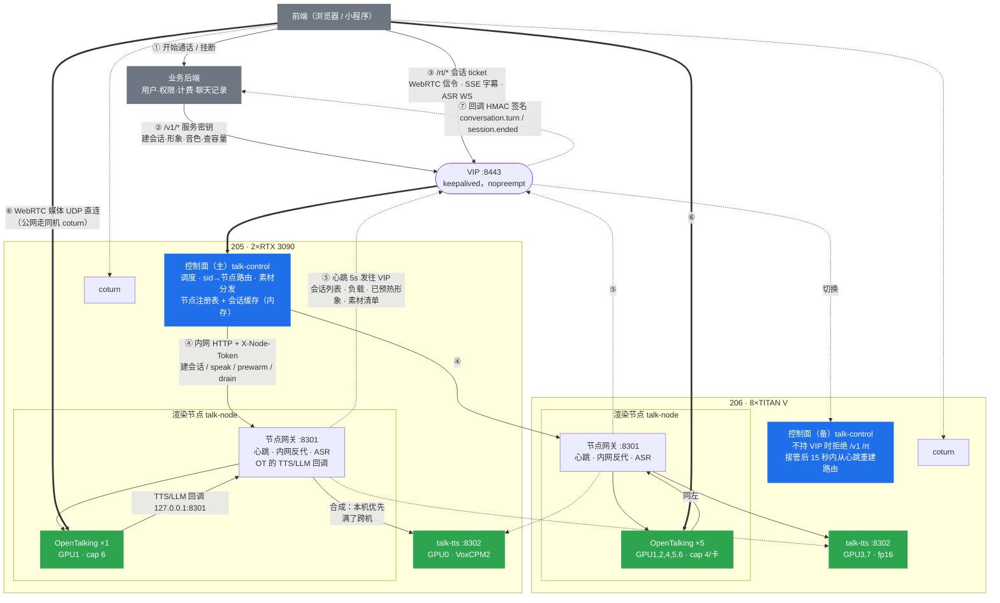
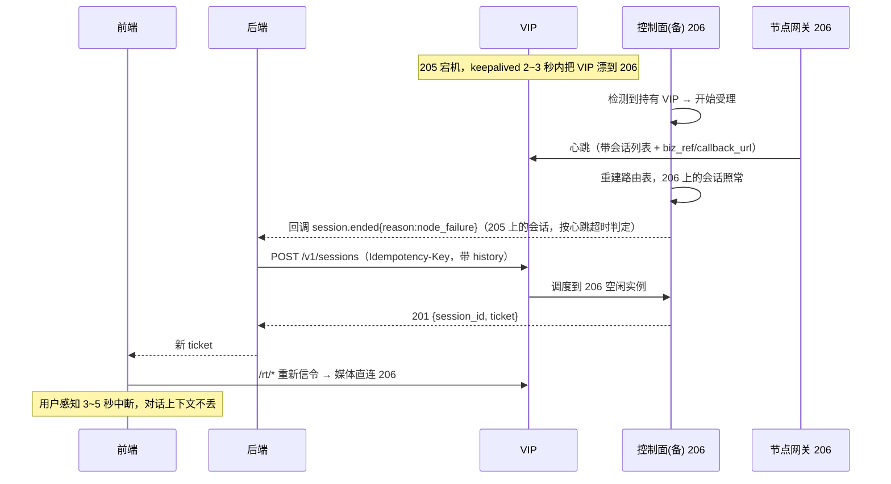

# 数字人 AI 服务端多机方案：接口、状态、调度、数据同步

> 2026-10-18 · 方案稿，尚未落地

## 背景
现在 talk 是「一台机器一个容器」：网关(8443) + 本机多个 OpenTalking 实例(8000+i，每卡一个) + gateway-local(8301，给 OT 回调 TTS/LLM) + talk-tts(8302)。
要做成多机服务，需要回答：服务要什么接口、要不要带状态、和后端怎么通信/调度/分发、要不要数据库同步。
**205/206 只用来验证架构（拆容器、调度、主备切换），正式落地从 2 台 8×RTX 4090 起步**，机器配置和容量规划见第九节。

## 〇、定位：前端 / 业务后端 / AI 服务端 三层，本方案只管 AI 服务端
- 业务后端只对接 **一个 AI 服务入口（控制面 base URL）**，不知道有几台 GPU 机。
- 控制面**只做 AI 资源的调度和路由**（选卡、会话路由、节点健康、素材分发），**不做业务逻辑**（用户、权限、计费、人设管理、聊天记录归后端）。
- 控制面是一个进程角色，不独占机器：两台时放在其中一台上，那台同时也是渲染/合成节点，两台一起干活。
- 调用链：前端 → 后端（鉴权）→ 控制面 `POST /v1/sessions` 拿 `session_id + 一次性 ticket` → 前端凭 ticket 直接和控制面做 WebRTC 信令/ASR WS → 媒体 UDP 直连所在 GPU 节点。音视频流不经过后端。
- 数据库：业务数据在后端已有的库里；AI 服务端不需要库，只存按 ID 寻址的素材文件 + 内存运行态。

## 〇.5、高可用：控制面主备（205 主、206 备）
- 206 上常驻一个备用控制面进程，平时不接流量；GPU 照常干活（渲染/合成两台都用，只有「控制面」这个角色是主备）。
- 切换：同网段用 keepalived 漂一个 VIP（如 <CONTROL_VIP>）给后端，205 挂了 VIP 自动漂到 206，后端无感；设 nopreempt，205 恢复后不抢回，避免来回切。不想用 VIP 就让后端配两个地址 + 健康检查自己切。
- 运行态不用同步：会话的完整元数据（含 callback_url、biz_ref、llm 配置）存在会话所在节点，心跳带给控制面；备控制面接管后 15 秒内重建路由表。ticket 是 HMAC 签名的无状态令牌，切换后仍有效。备机不持有 VIP 时拒绝受理，避免脑裂（详见第六节）。
- 205 上的会话随机器一起断（GPU 在那台上，无法挽救），前端重连 → 落到 206；206 上的会话不受影响。
- 必须去掉的单点：素材不能只放 205 的 NFS → 每台节点本地存全量，新形象/音色由主控制面同时推给所有节点；元数据 JSON 主控制面每次改动推给备控制面（或放进后端库，AI 侧只缓存）。TURN 服务两台各起一个。
- 降级：只剩 206 时容量减半，满了返回 503，后端提示排队。

## 一、先盘点现有状态（决定了多机要解决什么）

| 状态 | 现在在哪 | 多机后问题 |
|---|---|---|
| 会话→实例 `_owner`、预热表 `_warm` | 网关内存 (`gateway/ot_pool.py`) | 只有一个入口就没问题；多入口要共享 |
| 会话本身（WebRTC 连接、GPU 上的 worker、对话历史） | OT 进程内存 | **天然绑在某台机某张卡**，无法迁移 |
| 建形象任务进度 `JOBS` | 网关内存 (`animate.py`) | 同上，单入口无问题 |
| LLM 选择 | `state/gateway.json` | 小配置，单写者即可 |
| 克隆音色登记 + 参考 wav | `state/voices.json`、`state/voices/*.wav` | **合成节点都要能读到** |
| 形象素材 + 人脸缓存 | `/w/avatars` | **所有渲染节点都要有** |
| 模型权重 | 每机 `/w/models` | 部署时分发，不需同步 |
| OT→网关回调 | 写死 `127.0.0.1:8301`，`/v1/audio/speech`、`/v1/chat/completions` 只许本机 | 每个节点保留本地 8301 即可，不跨机 |
| WebRTC 媒体 | UDP 直连 OT 所在机器（host 网络） | 浏览器必须能直连**每台**渲染机 |

## 二、推荐架构：一个控制面 + N 个渲染节点 + M 个合成节点

### 架构图（以测试环境 205 + 206 标注；正式环境两台 4090 机对称，每台 = 控制面 + 7 渲染卡 + 1 合成卡，见第九节）



- 实线 = 控制/信令（HTTP、SSE、WS），全部进出控制面；粗线 = 音视频媒体，不经控制面也不经后端；虚线 = 心跳、回调、备用路径。
- 每台机三个容器：`talk-control`（可无 GPU）、`talk-node`（节点网关 + 本机所有 OpenTalking 实例）、`talk-tts`。控制面单独一个容器，重启渲染节点不会把入口一起带掉。

### 故障切换时序（205 整机宕机）



- **控制面**：现在网关的对外部分（页面、/api/*、/ot/* 反代、建会话调度、建形象任务、音色管理）。持有全局视图。
- **渲染节点**：就是现在的 talk 容器，去掉对外职责；节点上的 gateway-local 继续给本机 OT 提供 TTS/LLM 回调（OT 无需改），并把 TTS 请求转给合成池。ASR 也放节点（随会话走，和机器数一起扩，避免控制面要 GPU）。
- **合成节点**：talk-tts 本身无会话状态，任何节点都能合成任何音色，只要能读到参考 wav。

## 三、接口：哪里带状态

**原则：会话有状态且粘在一张卡上；其余一律无状态、ID 全局可解析。**

1. **对外只暴露控制面的 `/v1/*`（后端）和 `/rt/*`（前端）**，详见「对外接口设计」；现有 `/api/*`、`/ot/*` 保留给内部演示页。`session_id` 就是有状态句柄，所有会话请求都带它，控制面查 `sid → (节点, 实例)` 转发。不要让前端知道节点地址（除了 WebRTC 的 ICE 候选）。
2. **形象 ID、音色 ID 是全局 ID**，按值引用，任何节点拿到都能解析 → 所以每台节点都要有全量素材（见第五节）。
3. **新增内部接口**（控制面 ↔ 节点，内网 + `X-Node-Token`）：
   - 节点 → 控制面 `POST /internal/nodes/heartbeat`（每 5 秒）：`{node_id, role: render|tts, base_url, public_ip, gpu_model, instances:[{id, url, cap, sessions, talking, warm_avatars}], tts:{inflight, max}}`。控制面 15 秒没收到就判下线。
   - 控制面 → 节点：沿用 OT 现有 API（`/sessions`、`/avatars/{id}/prewarm`、`/sessions/{id}/speak` …），只是 URL 从 `127.0.0.1:800x` 变成 `节点IP:800x`（OT 改监听内网地址，或经节点网关反代——推荐后者，便于加 token）。
   - 控制面 → 节点 `POST /internal/avatars/{id}/sync`、`/internal/voices/sync`：新形象/新音色建好后通知节点从控制面拉取到本地 + 预热。
   - 控制面 → 节点 `POST /internal/drain`：发版时不再接新会话，等现有通话结束。
4. **合成池**：`/v1/audio/speech`、`/voices/register` 已有；`tts.py` 的 `LOCAL_TTS_URL` 改成列表，按 inflight 最少选；克隆音色注册广播到所有合成节点（或合成节点首次遇到未知音色时自己向控制面拉取参考 wav——更稳，推荐）。

## 四、通信与调度

- **通信方式**：控制类全用 HTTP/JSON；ASR 与 OT 事件继续 WS/SSE 经控制面反代（`app.py` 的 `ws_proxy`/`http_proxy` 已具备，只是上游换成远程地址）；媒体 WebRTC 直连。这个规模**不需要消息队列**，心跳 + 直接 HTTP 足够。
- **调度（把 `ot_pool.pick()` 推广到全局）**：
  - 候选 = 所有健康、非 draining 节点上的实例；
  - 排序 key：`(在线数/cap, 未预热该形象, 节点当前说话数, 节点id)`，cap 由节点按显卡上报（3090=6，TITAN V 另测），取代全局 `OT_MAX_SESSIONS_PER_INSTANCE`；
  - 先占位再建会话（现有 `pending:` token 机制保留）；全满回 503（现有逻辑）。
  - 合成池独立调度：按 inflight 最少，满了排队，不和渲染绑定。
- **故障**：节点挂了，其上的会话直接失效（实时音视频不做迁移），前端检测到断流 → 自动重新建会话（换节点，对话历史可由前端带最近几轮重放）。控制面从心跳里清掉该节点的 `_owner` 条目。
- **WebRTC 跨机**：每台渲染机的 OT 必须通告自己浏览器可达的 IP；同一内网（两台都在同一网段）直接可用；走公网/NAT 就要部署 coturn，`ice-config` 由控制面统一下发 TURN 地址（现在是取第一个实例的）。HTTPS 证书只在控制面需要。

## 五、要不要数据库

按数据性质分开处理，**第一阶段不需要数据库**：

| 数据 | 方案 |
|---|---|
| 运行时态（会话表、负载、预热、任务进度） | 单控制面：继续放内存（现状），节点心跳纠正；**多个控制面时**才上 Redis（带 TTL，占位用原子操作） |
| 小元数据（形象列表、音色登记、LLM 选择、人设） | 只有控制面写 → 继续 JSON/SQLite 放控制面；节点通过接口读，不各存一份。有用户账号/多入口时再迁 Postgres |
| 大文件（形象素材、底板视频、克隆 wav） | 每台节点本地存全量：新建时由主控制面推送，节点启动时比对清单补齐（不用单机 NFS，避免 205 挂了全都读不到）；机器多了再换 MinIO/对象存储 + 节点本地缓存 |
| 人脸缓存（prewarm 产物） | 各节点本地生成，不同步（现有「先一个实例做，再并行发其他」逻辑扩到所有节点） |
| 模型权重 | `deploy.sh` 按角色分发，不同步 |

一句话：**需要的是「单一真源 + 共享文件」，不是「多机数据库同步」**。让控制面是元数据唯一写者，就不会出现多机数据不一致。

## 五.5、对外接口设计（AI 服务端 → 业务后端 / 前端）

### 通用约定
- 地址：`https://<VIP>:8443`。两组接口：
  - `/v1/*`：给**业务后端**调（服务到服务），`Authorization: Bearer <服务密钥>`。
  - `/rt/*`：给**前端浏览器**调（实时通话），凭后端转交的会话 ticket（`X-Session-Ticket` 头，SSE/WS 用 `?ticket=`）；ticket 绑定单个会话，短时有效。
- JSON；错误统一 `{"error":{"code","message","retry_after?"}}`。
- 创建类请求支持 `Idempotency-Key` 头：主备切换时后端重试不会重复建会话/形象。
- ID 前缀：`av_` 形象、`vc_` 音色、`sess_` 会话、`job_` 任务。AI 侧不存用户信息，后端可传 `biz_ref`（透传，用于对账和回调关联）。
- 耗时操作（建形象 1~3 分钟）走「202 + job + 回调」。

### 1. 状态与容量
| 方法 | 路径 | 说明 |
|---|---|---|
| GET | `/v1/health` | `{status, role: primary\|standby, nodes:[{id, ok, instances_ok}]}` |
| GET | `/v1/capacity` | `{online, max_online, talking, available}`，后端可在「开始通话」前预判是否要排队 |

### 2. 形象
| 方法 | 路径 | 说明 |
|---|---|---|
| POST | `/v1/avatars` | multipart：`image`、`name`、`animate`(是否生成动态底板)、`callback_url?`、`biz_ref?` → `202 {avatar_id, job_id}` |
| GET | `/v1/avatars/{id}` | `{id, name, status: processing\|ready\|failed, animated, preview_url, created_at}` |
| GET | `/v1/avatars?type=builtin` | 内置形象列表 |
| DELETE | `/v1/avatars/{id}` | 从所有节点删除 |
| GET | `/v1/avatars/{id}/preview` | 封面图（返回签名 URL，前端可直接展示） |

### 3. 音色
| 方法 | 路径 | 说明 |
|---|---|---|
| GET | `/v1/voices/presets` | 系统音色分组（含推荐年龄段）+ 支持的方言列表 |
| POST | `/v1/voices/clone` | multipart：`audio`(≤20MB，截前 20 秒)、`name`、`biz_ref?` → `{voice_id, ref_text, status}` |
| GET | `/v1/voices/{id}` | 音色信息 |
| DELETE | `/v1/voices/{id}` | 删除（所有合成节点） |
| GET | `/v1/voices/{id}/preview?dialect=` | 试听 mp3 |

### 4. 任务
| GET | `/v1/jobs/{id}` | `{status: queued\|running\|done\|failed, step, progress, result, error}` |
|---|---|---|

### 5. 会话（核心）
`POST /v1/sessions`
```json
{
  "avatar_id": "av_xxx",
  "voice_id": "vc_xxx", "dialect": "四川话",
  "persona": { "system_prompt": "……" },
  "llm": { "mode": "builtin", "provider": "ark" },
  "history": [{"role":"user","content":"…"},{"role":"assistant","content":"…"}],
  "idle_timeout_s": 120, "max_duration_s": 1800,
  "queue": false,
  "biz_ref": "order_123", "callback_url": "https://backend/ai/callback"
}
```
- `llm.mode`：
  - `builtin`：AI 侧用内置 LLM（豆包/MiniMax）+ `system_prompt` 回复；
  - `external`：AI 侧调后端提供的 OpenAI 兼容地址（`llm.url`、`llm.api_key`），后端可以加知识库、做内容审核、存历史；
  - `none`：不走 LLM，只按后端 `speak(mode=say)` 下发的文本念。
- `history`：断线重连/切换节点后接着聊，由后端把最近几轮带回来。
- 返回 `201`：
```json
{ "session_id": "sess_xxx", "ticket": "…", "ticket_expires_at": "…",
  "rt_base_url": "https://<VIP>:8443/rt", "expires_at": "…" }
```
- 满员：`503 capacity_full` + `retry_after`；`queue:true` 时返回 `202 {state:"queued", position}`，排到后通过 SSE `session.state_changed` / 回调通知。

| 方法 | 路径 | 说明 |
|---|---|---|
| GET | `/v1/sessions/{id}` | `{state: queued\|created\|live\|ended\|failed, speaking, started_at, ended_reason?}` |
| PATCH | `/v1/sessions/{id}` | 通话中换 `voice_id` / `dialect` / `system_prompt` |
| POST | `/v1/sessions/{id}/speak` | `{text, mode: chat\|say}`：`chat` 当作用户说的话走 LLM，`say` 让数字人原样念（播报、开场白） |
| POST | `/v1/sessions/{id}/interrupt` | 打断当前说话 |
| POST | `/v1/sessions/{id}/ticket` | 重新签发 ticket（前端页面刷新、重连） |
| DELETE | `/v1/sessions/{id}` | 挂断，返回用量 `{duration_s, talk_s, tts_chars, llm_tokens}`，用于计费 |

### 6. 前端实时接口（`/rt/*`，ticket 鉴权）
| 方法 | 路径 | 说明 |
|---|---|---|
| GET | `/rt/sessions/{id}/ice-config` | STUN/TURN 配置 |
| POST | `/rt/sessions/{id}/webrtc/offer` | `{sdp, type}` → answer（信令经控制面，媒体直连 GPU 节点） |
| POST | `/rt/sessions/{id}/start` | 开始推流 |
| GET | `/rt/sessions/{id}/events` | SSE：`session.state_changed`、`speech.started`、`subtitle.chunk{text,is_final}`、`speech.ended`、`asr.result{text}`、`session.ended{reason}` |
| WS | `/rt/sessions/{id}/asr` | 语音输入：先发 `{"type":"meta"}`，再发 16k s16le PCM，最后 `{"type":"end"}`，回 `{text}` 或 `{error}`（沿用现有协议） |
| POST | `/rt/sessions/{id}/interrupt` | 用户开口即打断 |
| POST | `/rt/sessions/{id}/text` | 打字输入 = speak(mode=chat) |

前端不能直连 AI 域名时，后端可以原样反代 `/rt/*`（HTTP/SSE/WS），但 WebRTC 媒体仍须直连 GPU 节点或 TURN。

### 7. 回调（AI → 后端，`callback_url`）
- 带 `X-Signature: HMAC-SHA256(body, 回调密钥)`、`event_id`（后端按它去重），失败按 1s/5s/30s/2min 重试。
- 事件：`avatar.ready` / `avatar.failed`、`voice.ready`、`session.started`、`conversation.turn{user_text, bot_text, ts}`（后端以此存聊天记录）、`session.ended{reason: hangup|idle_timeout|max_duration|node_failure|error, usage}`。
- `node_failure`：后端带 `history` 重新 `POST /v1/sessions`，前端用新 ticket 重连 → 用户只感到 1~3 秒中断。

### 8. 状态边界小结
- 唯一的有状态句柄是 `session_id`（粘在某张卡上）；ticket 是它的短期浏览器凭证。
- 形象、音色是全局 ID，任何节点、主备任意一端都能解析。
- 对话记录的真源在后端（回调 `conversation.turn`）；AI 侧只在会话期间保留上下文，重连时靠 `history` 恢复。
- 用量在 `DELETE` 返回和 `session.ended` 回调中各给一次，以回调为准。

### 9. 一次通话的时序
1. 前端 → 后端「开始通话」（后端鉴权、扣额度）
2. 后端 → `POST /v1/sessions` → 拿到 `session_id` + `ticket`，转交前端
3. 前端 → `/rt/.../events`(SSE)、`ice-config`、`webrtc/offer`、`start`、`asr`(WS)
4. 通话中：字幕走 SSE 给前端；`conversation.turn` 回调给后端存档
5. 挂断：前端 → 后端 → `DELETE /v1/sessions/{id}`；或超时由 AI 侧自动结束 → `session.ended` 回调

## 六、方案复盘：遗漏与优化

### 6.1 必须补上的（不补会出事故）

| # | 问题 | 后果 | 对策 |
|---|---|---|---|
| 1 | **会话元数据只在控制面内存**（callback_url、biz_ref、llm 配置、ticket 表） | 主备切换后备机接管了路由，但不知道该回调谁、external LLM 调哪、ticket 全失效 | **状态放在 GPU 所在的节点上**：建会话时控制面把整份会话元数据交给节点保存，心跳带回来；控制面只是可重建的缓存。ticket 改成 HMAC 签名的无状态令牌（共享密钥，两边都能校验） |
| 2 | **脑裂**：网络分区时 205、206 都以为自己是主 | 两个控制面同时调度，同一张卡被超卖；后端收到重复回调 | 备机不持有 VIP 就拒绝 `/v1`、`/rt`（返回 503 + `Retry-After`）；节点心跳只发 VIP；keepalived 加 `vrrp_script` 检查控制面进程健康，不只看机器通不通 |
| 3 | **Idempotency-Key 存内存** | 切换时后端重试照样重复建会话 | 建会话的幂等由节点兜底：`biz_ref` 相同且在线的会话直接返回已有 `session_id`（心跳里有） |
| 4 | **外部回调无法送达时丢事件**（控制面重启、后端短暂不可用） | 聊天记录缺轮次、`session.ended` 丢了就无法计费 | 节点 → 控制面 `POST /internal/events`，节点本地磁盘 spool + 重试；控制面落盘后再发后端，`event_id` 幂等；`session.ended` 的用量由节点算（OT 有计时），不依赖控制面 |
| 5 | **per-session LLM/人设配置没下发到节点**（现在 provider 是全局 `state/gateway.json`） | `external` 模式和每会话 `system_prompt` 做不了 | 节点网关 `/v1/chat/completions` 按 `session_id` 查本地会话表选 provider / url / key；OT 创建会话时就带 `llm_system_prompt`（现有字段） |
| 6 | **素材推送时节点离线**，或删除没传到 | 节点上缺形象 → 建会话失败 / 已删音色仍可用 | 心跳带素材清单哈希，控制面比对差异后主动补推/补删；节点启动先对账再上线 |
| 7 | **建形象任务（1~3 分钟，调 MiniMax H3）只在内存** | 控制面重启 = 任务丢，用户传的照片白传 | 任务落盘（`state/jobs/*.json` + 原图），重启续跑或标 failed 并回调 `avatar.failed`；备机不需要同步任务，失败即重试 |
| 8 | **idle/max 超时谁执行** | 控制面挂了超时没人管，会话占着卡 | 超时由节点本地定时器执行（会话在哪超时就在哪算） |
| 9 | **没有可观测性** | 200 人在线出问题只能看日志 | 每节点暴露 Prometheus 指标：在线/说话路数、GPU 利用率、首包/开口延迟、TTS RTF、掉帧；`X-Request-Id` 从后端一路透传到节点；控制面 `/v1/health` 暴露每个实例的实时负载 |
| 10 | **HTTPS 证书 & 时间** | VIP 域名证书两台都要有；ticket 过期判断依赖时钟 | 证书同时部署两台（同一份）；两台跑 NTP |
| 11 | **公网 WebRTC** | 内网直连没问题，一上公网 UDP 过不去就黑屏 | 每台渲染机固定 UDP 端口段 + `PUBLIC_HOST`；coturn 每台一个，`ice-config` 下发**会话所在机**的 TURN；symmetric NAT 用户走 TURN 中继，带宽按 1.5 Mbps/路预留 |
| 12 | **安全细节** | `/rt` 被刷、上传恶意文件、内网接口裸奔 | `/rt` 按 ticket 限速；上传校验 MIME + 像素上限 + 人脸检测失败回 `avatar.failed`；`/internal/*` 只绑内网网卡 + token；回调密钥和服务密钥支持双密钥轮换 |

### 6.2 值得优化的（提升体验 / 容量 / 简化运维）

- **本机优先的合成调度**：渲染节点先用同机 talk-tts，满了再跨机。省一次 LAN 往返（克隆音色首包更敏感），跨机只在峰值出现。
- **调度按机器快慢加权**：3090 开口比 TITAN V 快，评分加 `节点权重`，在负载相近时优先快卡；预热命中权重调高（冷形象首次构建会卡同卡的其他会话）。
- **自适应 cap**：节点上报掉帧率 / GPU 利用率，控制面在实例连续掉帧时临时下调 cap（1:2 超卖是静态估计，热门时段会超）；恢复后回升。
- **心跳 + 即时增量**：会话开始/结束时节点立即推一条增量，不等 5 秒心跳，避免并发建会话时按旧负载分流挤到同一张卡。
- **热门形象常驻预热池**：心跳统计各形象使用频率，控制面让所有节点保持 Top-N 形象 warm；新节点上线先预热它们再接流量。
- **预建会话**：后端在用户进入「准备页」时就 `POST /v1/sessions`，用户点通话时信令直接走，省 2~3 秒。`idle_timeout` 兜底回收。
- **优先级与预留**：`POST /v1/sessions` 加 `priority: normal|high`，每节点预留 1 个说话槽给 high，付费用户不被排队。
- **会话录制（可选）**：`record: true` 时节点本地录混合音频 + 字幕，结束后上传到对象存储并在 `session.ended` 回调里给 URL；合规和复盘都要用。
- **容量到 4 台以上再做的事**：运行态上 Redis（多控制面 active-active，占位用 `SET NX EX`）、素材上 MinIO（节点只缓存）、节点自动注册（现在用 `scripts/hosts/*.env` 手工配够用）。
- **不需要做的**：消息队列、服务网格、会话迁移（WebRTC + GPU worker 迁不走，重连成本更低）、多 Region。

### 6.3 一句话原则
**状态跟着 GPU 走，控制面只是可重建的缓存，后端是业务真源。** 守住这条，主备、扩容、重启都不用做数据同步。

## 七、落地步骤（第一阶段：205 + 206 两机）

1. **拆容器**：`talk-control`（控制面，无 GPU）、`talk-node`（节点网关 + 本机 OT 实例）、`talk-tts`；`entrypoint.sh` 按 `ROLE` 起不同进程。
2. **节点网关**（基于现有 `gateway/app.py` 瘦身）：本地会话表（元数据落盘）、`/internal/*` 反代 + token、心跳（会话列表、负载、warm、素材清单哈希）、ASR、OT 的 TTS/LLM 回调按会话选 provider、超时定时器、事件 spool。
3. **控制面**：`ot_pool.py` 改成节点注册表 + 全局 `pick()`（cap/warm/权重/预留）；`/v1/*`、`/rt/*` 新接口 + HMAC ticket；`/internal/events` 落盘后回调后端；素材分发与对账；不持 VIP 时拒绝受理。
4. `gateway/tts.py`：合成池列表、本机优先、最少 inflight；talk-tts 未知音色时向控制面拉参考 wav。
5. 任务落盘（`animate.py` 的 `JOBS` → `state/jobs/`），重启续跑。
6. 主备：206 起备用控制面 + keepalived VIP（nopreempt + 健康脚本）；证书两台同步；TURN 两台各一个。
7. 可观测：节点和控制面暴露 `/metrics`，`X-Request-Id` 透传。
8. `scripts/deploy.sh` + `scripts/hosts/*.env`：按角色部署，205=主控制面+渲染+合成，206=备控制面+渲染+合成。

## 八、验证
- 两机都起来后 `GET /health` 显示两节点全部实例在线；`scripts/smoke.py` 指向控制面跑通。
- `scripts/loadtest.py` 开 14 路以上，确认会话分到两台机、无卡顿；各节点心跳上报的在线数与控制面一致。
- 在 206 上建的形象/克隆的音色，205 上的会话能直接用。
- 通话中 `docker stop` 一台渲染节点：控制面 15 秒内摘掉它，前端重连后落到另一台。
- drain 一台节点后新会话不再分过去，老会话正常结束。
- 停掉 205：VIP 漂到 206，后端无感；206 上的会话不断，205 上的会话收到 `node_failure` 后重连成功；切换前签发的 ticket 在 206 仍可用。
- 拔掉 205/206 之间的网线（模拟分区）：只有持 VIP 的一方受理，另一方返回 503，后端没有重复回调。
- 杀掉控制面进程再拉起：节点 spool 里的事件补发到后端，`event_id` 不重复；进行中的建形象任务续跑。
- 推送素材时让 206 节点离线 5 分钟，恢复后清单对账把缺的补齐。

## 九、目标规模：2 台 8×RTX 4090 起步

### 9.1 和测试环境的差别
- **两台机器完全对称**（同卡、同镜像、同配置），主备就是镜像关系：每台 = `talk-control`（一主一备）+ `talk-node`（7 个 OT 实例）+ `talk-tts`（1 卡）。不再有 205/206 那种「一台 3090 一台 Volta」的异构，第六节里「按机器快慢加权」「Volta fp16 补丁」第一期都不需要。
- 4090 是 Ada 架构：bf16、flash-attn 都有，直接用 205 的镜像和 `.env`，不用 206 的 `patch_volta`。
- 扩到第 3、4 台时新机器只跑 `talk-node` + `talk-tts`，控制面仍是前两台主备；到 4 台以上再考虑 Redis / MinIO（第六节 6.2）。

### 9.2 单机分工与容量（估算，上线前必须在第一台 4090 上用 `scripts/loadtest.py` 实测）

| 项 | 3090 实测（205） | 4090 估算 | 说明 |
|---|---|---|---|
| 单卡渲染：稳定说话路数 | 3（有待机会话时） | 4~5 | 4090 FP16 算力约 3090 的 2 倍，QuickTalk 不是纯算力瓶颈，保守按 1.5 倍 |
| 单卡渲染：在线上限 cap（1:2） | 6 | 9 | 心跳按实测再调 |
| 单卡合成（VoxCPM2）并发 | 32 seqs 配置，够 ~60 路在线 | ~100 路在线 | 合成只在说话时占用 |
| 单机 7 渲染 + 1 合成 | — | **约 60 在线 / 30 同时说话** | 合成 1 卡略有余量，渲染是瓶颈 |
| **两台合计** | — | **约 120 在线 / 60 同时说话** | 单台宕机降级到一半 |
| 200 在线目标 | — | 4 台（23 渲染卡 + 3 合成卡 + 预留） | 与之前估算一致 |

若实测 4090 单卡能稳 5 路说话，cap 可调到 10，两台到 140 在线。

### 9.3 测试阶段（205/206）要测出来、正式机才好配的数字
1. **每路会话的 CPU 占用**：OpenTalking 的 WebRTC 推流/编码在 CPU 上跑，且受 GIL 限制（前期压测结论）。7 个实例 × 9 路 = 63 路/机，CPU 可能先于 GPU 见顶 → 在 205 上记录「每路说话/待机各占多少核」，据此定 4090 机的 CPU 规格（建议 ≥ 32 物理核，内存 ≥ 256G）。
2. **每路带宽**：视频 + 音频下行约 1~1.5 Mbps/路，63 路 ≈ 100 Mbps/机，加 TURN 中继翻倍 → 万兆内网 + 公网出口按 300 Mbps/机预留。
3. **节点网关单进程能扛多少路**：ASR（SenseVoice）、TTS 回调转发、心跳都在一个进程里，63 路时是否够；不够就 ASR 单独一个进程/一张卡的一角。
4. **素材分发耗时**：动态底板视频每个形象几十 MB，推到所有节点 + 预热要多久，决定 `avatar.ready` 回调的预期时间。
5. **主备切换实际时长**：从 kill 205 到 206 可受理、到前端重连成功，各段耗时，写进给后端的 SLA。

### 9.4 正式机硬件建议（每台）
- GPU：8×RTX 4090 24G
- CPU：≥ 32 物理核（视 9.3-1 实测结果上调），内存 ≥ 256G
- 磁盘：NVMe ≥ 2T（模型 + 形象素材本地全量 + 日志/录制）
- 网络：万兆内网；公网固定 IP 且放通 UDP 端口段（WebRTC + coturn）
- 系统：驱动 ≥ 550、docker + nvidia-container-toolkit、NTP、keepalived

## 十、离线生产线：闲时视频生成（H3 本地）与多模态人设构建

两类新需求都不是实时通话，属于「离线任务」：吃 GPU 的（H3 生成）和吃 API/CPU 的（人设抽取）。统一做成**一个离线任务队列**（控制面持有，落盘），和实时通话抢资源时实时优先。

### 10.1 形象变体：H3 本地闲时生成（背景、服装、姿态、待机动作）

**要生成什么**：同一个人脸的多套「底板视频」——换背景（办公室/直播间/户外）、换服装（正装/休闲/节日）、换姿态/手势、不同待机动作。每套底板 = 一个 `variant`，挂在形象下（`av_xxx` → `var_xxx`），QuickTalk 口型融合不变。

**为什么本地跑**：MiniMax 云端 H3 按条计费且排队不可控；本地 H3 已在 205 跑通（`talk/h3/`：ComfyUI + INT8 FL2VA + NVFP4 文本编码器 + 4 步 LoRA），单张 24G 卡 544×736、6.6 秒片段约 160 秒，显存占满 → **一个 H3 任务独占一张卡**，不能和渲染同卡。4090 机驱动 ≥550 可用 INT8 视频 VAE，预计快 30~40%。

**部署策略（三档，按在线负载自动切换）**：

| 档位 | 条件 | 做法 |
|---|---|---|
| 夜间批量 | 00:00–07:00 或在线 < 20% | 每台机 drain 2 个渲染实例，借 2 张卡跑 H3（`talk-h3` 容器按需 `docker start`，常驻会占显存） |
| 白天低峰 | 在线 < 50% 持续 10 分钟 | 每台机借 1 张卡（drain 该实例，等其上会话结束后启动） |
| 高峰 | 在线 ≥ 50% 或任一实例满 | 不借卡；正在跑的任务**做完当前片段即停**（每条 ≤3 分钟，不中途杀），归还卡、重新 prewarm 热门形象后再接流量 |

- 借卡顺序固定（每台机 GPU6 → GPU5），归还顺序相反，避免所有实例都被扰动。
- `priority: urgent` 的任务不等闲时：走 **MiniMax 云端 H3 API**（现有 `animate.py` 路径），按条计费，由后端决定要不要花这个钱。
- 产物流程：生成 → 首尾帧接缝检查（现有 `_seam_ratio`，不达标自动重试换种子，最多 3 次）→ 登记为 variant → 推送到所有节点 → 各节点 prewarm → 回调 `variant.ready`。
- 容量影响：夜间借 2 卡每台少 18 在线，白天借 1 卡少 9；两台一晚（7 小时 × 4 卡 × ~20 条/卡/小时）≈ **500 条底板**，够用。

**接口（后端 `/v1/*`）**

| 方法 | 路径 | 说明 |
|---|---|---|
| POST | `/v1/avatars/{id}/variants` | `{kind: background\|outfit\|pose\|idle, prompt, reference_image?(url/上传), duration_s: 6, seed?, priority: idle\|normal\|urgent, callback_url?, biz_ref?}` → `202 {variant_id, job_id, eta}`；`idle` 只在闲时跑、`normal` 低峰即跑、`urgent` 走云端 API |
| GET | `/v1/avatars/{id}/variants` | 变体列表 `[{variant_id, kind, prompt, status: queued\|generating\|checking\|distributing\|ready\|failed, preview_url, created_at}]` |
| GET | `/v1/variants/{vid}` | 单个变体详情 + 预览视频 URL |
| DELETE | `/v1/variants/{vid}` | 从所有节点删除 |
| POST | `/v1/variants/{vid}/retry` | 失败/不满意时换种子重做 |
| GET | `/v1/offline/queue` | 队列状态：`{pending, running:[{job, node, gpu, progress}], borrowed_gpus, policy}` |
| PATCH | `/v1/offline/policy` | 调三档阈值 / 夜间时段 / 每台最多借几张卡 |

**会话里用变体**
- 建会话：`POST /v1/sessions` 加 `variant_id`（不传 = 形象默认底板）。
- 通话中切换：`PATCH /v1/sessions/{id} {variant_id}` → 节点上该变体已 prewarm 则在下一次待机间隙换底板（需给 `opentalking_patch.py` 加「热切底板」，QuickTalk 底板帧序列可替换，人脸缓存同一张脸可复用）；不支持热切时兜底为「同 sid 内部重建 OT 会话」，前端看到约 1 秒过渡画面，SSE 发 `session.variant_changed`。
- 调度加分项：建会话时优先挑已预热该 `variant` 的实例（`_warm` 的 key 从 avatar 改为 variant）。

### 10.2 多模态素材 → 结构化人设

**目标**：客户上传一堆素材（公司介绍 PDF、产品图、销售话术文档、老师讲课录音/视频、公众号链接……），AI 端抽取成**结构化人设**，而不是让客户手写 system_prompt。人设是可版本化、可审核、可复用到多个形象/音色的独立对象（`ps_xxx`）。

**结构化人设 schema（v1）**
```json
{
  "persona_id": "ps_xxx", "version": 3, "status": "draft|approved",
  "identity":   {"name": "…", "role": "…", "org": "…", "intro": "一句话自我介绍"},
  "background": ["学历/经历/成就 要点"],
  "style":      {"tone": "亲切|专业|幽默…", "pace": "短句为主", "catchphrases": ["…"], "address_user": "您/你/同学",
                 "dialect_hint": "四川话", "examples": [{"user": "…", "bot": "…"}]},
  "knowledge":  {"facts": ["可直接回答的事实要点"], "faq": [{"q": "…", "a": "…"}],
                 "products": [{"name": "…", "points": ["…"]}], "sources": ["mat_xxx"]},
  "boundaries": {"forbidden": ["不谈竞品价格", "不承诺疗效"], "fallback": "超出范围时怎么说", "handoff": "转人工话术"},
  "recommend":  {"voice_id": "vox_f_30s", "avatar_hint": "正装 办公室背景", "opening": "开场白"},
  "compiled":   {"system_prompt": "由以上字段编译", "prompt_tokens": 1800, "knowledge_mode": "inline|external"}
}
```

**处理流水线（跑在控制面所在机，GPU 只用一点 ASR）**

| 素材类型 | 处理 | 用什么 |
|---|---|---|
| 文本 / PDF / Word / 网页 URL | 抽正文 → 分块 → LLM 抽取要点、FAQ、话术、禁区 | 现有 `llm_router`（豆包 / MiniMax-M3） |
| 图片（产品图、海报、名片、PPT 截图） | VLM 描述 + OCR → 进 knowledge；人像图可顺手建形象 | 豆包 vision（方舟）；人像走 `/v1/avatars` |
| 音频（讲课、直播、访谈） | ASR 转写 → 抽风格（口头禅、称呼、节奏）+ 知识；可一键克隆音色 | SenseVoice（节点）；克隆走 `/v1/voices/clone` |
| 视频 | 抽音轨同上 + 关键帧 VLM（着装、场景 → `avatar_hint` 和变体 prompt） | ffmpeg + VLM |

- 每份素材一个 `material`，可单独删除、重新抽取；人设 = 多份素材的合并 + 人工修改，每次保存 +1 版本，会话固定引用某一版本（通话中不会因为编辑而变）。
- **知识量分档**：编译后 prompt ≤ 3k tokens 直接内联（`knowledge_mode: inline`，豆包 mini 首字 0.4 秒不受影响）；超过则只内联 identity/style/boundaries，知识走 `external`：后端用返回的 `knowledge` 块建向量库，会话 `llm.mode=external` 由后端做 RAG。AI 端第一期**不做向量库**（又要多一套状态）。
- 审核：`draft` 状态可试聊（`POST /v1/personas/{id}/chat` 纯文本对话，不占 GPU），满意后 `approve`；只有 approved 版本能用于正式会话（后端可放开）。
- 存储：素材文件 + 人设 JSON 在控制面（落盘并同步备机）；归属/权限/计费在后端，用 `biz_ref` 关联。

**接口（后端 `/v1/*`）**

| 方法 | 路径 | 说明 |
|---|---|---|
| POST | `/v1/personas` | `{name, biz_ref?, seed?: {identity, style…}}` → `{persona_id, version: 1}`；可从空白或手填字段起步 |
| POST | `/v1/personas/{id}/materials` | multipart：`file` 或 `url`，`kind: doc\|image\|audio\|video\|url`，`hint?`（"这是销售话术"）→ `202 {material_id, job_id}`；单文件 ≤200MB，音视频 ≤60 分钟 |
| GET | `/v1/personas/{id}/materials` | 素材列表 + 各自抽取状态/摘要 |
| DELETE | `/v1/personas/{id}/materials/{mid}` | 删素材并标记人设需重新合并 |
| POST | `/v1/personas/{id}/build` | 合并所有素材 → 新版本（`202 job`），回调 `persona.built{version, diff_summary}` |
| GET | `/v1/personas/{id}?version=` | 结构化人设 JSON（默认最新版） |
| PATCH | `/v1/personas/{id}` | 人工改任意字段 → 新版本并重新编译 |
| POST | `/v1/personas/{id}/chat` | `{messages}` 文本试聊，用当前编译结果，不占 GPU，流式返回 |
| POST | `/v1/personas/{id}/approve` | 标记 approved；返回 `compiled` 摘要和 `knowledge_mode` 建议 |
| GET | `/v1/personas/{id}/export` | 导出 `compiled.system_prompt` + `knowledge` 全量（后端建 RAG 用） |
| DELETE | `/v1/personas/{id}` | 删除人设及素材 |

**会话里用人设**：`POST /v1/sessions` 的 `persona` 字段支持 `{persona_id, version?}`（替代手写 `system_prompt`，两者可叠加：`extra_prompt` 追加场景指令）；`knowledge_mode=external` 的人设必须配 `llm.mode=external`，否则 400。

**回调事件新增**：`material.extracted{material_id, summary}` / `material.failed`、`persona.built{version}`、`variant.ready{variant_id}` / `variant.failed`。

### 10.3 离线任务队列（两类任务共用）

- 控制面维护 `state/jobs/`（已在第六节要求落盘），任务带 `needs_gpu: true|false`、`priority`、`biz_ref`、重试次数。
- `needs_gpu` 任务只在借到卡时派发到对应节点的 `talk-h3` 容器（节点网关 `POST /internal/h3/run`，流式回进度）；非 GPU 任务控制面本地线程池跑（PDF 解析、调 LLM/VLM）。
- 公平性：同一 `biz_ref` 最多同时 2 个任务在跑，防止一个客户一次传 50 个视频把队列占满。
- 可观测：队列长度、等待时长、借卡时长、H3 每条耗时进指标；`/v1/offline/queue` 给后端做进度页。
